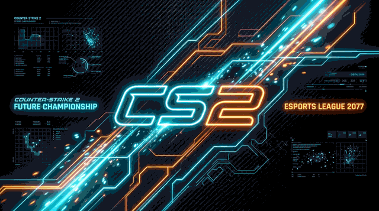
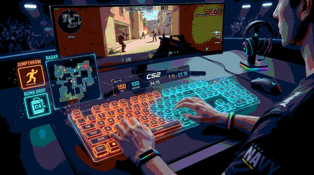

<p align="center">
  
</p>

<h1 align="center">⚡ CS2 Competitive Autoexec 2026</h1>

<p align="center">
  <b>Турнирный соревновательный конфигурационный пакет для Counter-Strike 2.</b><br/>
  <i>The Ultimate Competitive CS2 Autoexec · Esports Settings (donk, ZywOo, sh1ro, m0NESY) · Sub-Tick Precision · Zero Input Lag · Smart Keybinds Hub · Premier & Faceit Ready.</i>
</p>

<p align="center">
  <a href="https://github.com/Vektor010/cs2-autoexec/releases/latest"></a>&nbsp;&nbsp;
  <a href="https://github.com/Vektor010/cs2-autoexec/stargazers"></a>&nbsp;&nbsp;
  <a href="https://t.me/nexcorepc" target="_blank"></a>&nbsp;&nbsp;
  <a href="https://www.youtube.com/@Skylake159" target="_blank"></a>
</p>

<p align="center">
  
  
  
  
  
  
  
</p>

---

## 🌟 Главные фишки конфига (Esports Highlights)

Конфигурация оптимизирована под соревновательные режимы **Premier** и **Faceit** на основе актуальных сетапов игроков мировой про-сцены (**donk**, **ZywOo**, **sh1ro**, **m0NESY**):

* 🚀 **Максимум FPS & Zero Lag:** `engine_no_focus_sleep 0`, `cl_net_buffer_ticks 0`, `battery_saver false` и `rate 1000000` — задержка ввода сведена к минимуму, стабильный фреймтайм без микрофризов и мгновенный отклик мыши.
* 🎧 **Кристально чистый звук:** Профиль **Crisp EQ** выводит шаги врагов и чеку гранат на передний план, отсекая басовый гул взрывов. Стереоизоляция 75% обеспечивает точный азимут звука, фоновый шум меню и карты полностью отключен (`snd_menumap_volume 0.00`, `snd_musicvolume 0.00`), а 10-секундный таймер бомбы откалиброван на комфортные 12% (0.0144 — не глушит уши в клатче). Плавный 21-ступенчатый микшер громкости на `=` / `-` с моментальным цветным логом в консоли!
* 🎯 **Турнирный прицел + Фикс оптики:** Красный `Static Cross 2/2/0` с точкой без обводки. Отключено раздражающее предупреждение при наведении на своих (`cl_crosshair_friendly_warning 0`), исправлен баг исчезающей точки в зуме **AUG / SG 553** (`cl_ironsight_dot_scale 1`), настроены чёткие риски AWP без мыла в движении и быстрая регулировка размера/зазора стрелками с шагом 1 px прямо в матче.
* ⌨️ **Умные киберспортивные бинды:**
  * 💣 **Мгновенный сброс пачки (`J`):** Дроп C4 под ноги или тиммейту за долю секунды без доставания бомбы в руки.
  * 🤸 **Jumpthrow sh1ro (`Пробел + C / K`):** Идеальные раскидки гранат под большой палец со 100% повторяемостью.
  * 🔄 **Анатомическая инверсия `Shift / Ctrl`:** Приседание на длинный Shift снимает напряжение с мизинца при крауч-мувменте.
  * 🔇 **Быстрый мут (`End`) & Режим Clutch (`F5`):** Мгновенно заглушить звук игры в дискорде или замутить тиммейтов в клатче одной кнопкой.
  * 🧹 **Очистка консоли (`Home`) & Радио (`Delete`):** Чистая консоль в один клик и глушение радио-спама ботов/тиммейтов (`ignorerad`).
  * 📸 **Скрытие HUD (`F8`) & SDR-статистика (`F9`):** Мгновенное скрытие интерфейса для чистых скриншотов (`toggle cl_drawhud 0 1`) и вывод расширенной сетевой телеметрии SDR в консоль.
  * 🖱️ **Классический скролл оружия:** Колёсико мыши (`MWHEELUP / MWHEELDOWN`) для быстрого выбора оружия, прыжок зафиксирован на пробел.
  * 🛒 **Возврат покупок (`Backspace`):** Мгновенная отмена всех покупок во фризтайме, если мискликнул в магазине.
* 🖥️ **Соревновательный минимализм интерфейса:** Радар охватывает всю карту сразу (динамический зум на `MOUSE4`), вверху — 5 подробных карточек тиммейтов с HP и цветами, а весь отвлекающий визуальный мусор выключен.
* 💬 **Умный чат (`F10`):** 30 отборных англоязычных трэш-ток фраз (без мата и банов) для деморализации соперников в соло-матчах.

---

## 🚀 Быстрая установка за 30 секунд (Quick Install)

### 1. Скачивание
Скачайте готовый архив [**`autoexec.zip`**](https://github.com/Vektor010/cs2-autoexec/releases/latest) и распакуйте его содержимое в каталог конфигураций CS2:
```text
<SteamLibrary>\steamapps\common\Counter-Strike Global Offensive\game\csgo\cfg\
```
*(Либо склонируйте репозиторий: `git clone https://github.com/Vektor010/cs2-autoexec.git`)*.

### 2. Параметры запуска Steam (Launch Options)
Откройте **Steam** ➔ **Библиотека** ➔ ПКМ по **Counter-Strike 2** ➔ **Свойства** ➔ в поле «Параметры запуска» вставьте:
```text
-novid -nojoy +exec autoexec
```

### 3. Проверка в игре
В любой момент в игре откройте консоль (`~`) и введите:
```text
ae
```
В консоли отобразится цветная статус-панель с подтверждением загрузки всех модулей.

---

## 🎛️ Центр соревновательных настроек и биндов

<p align="center">
  
</p>

### 🎯 1. Киберспортивный прицел и калибровка оптики (Crosshair & Optics)

Прицел выверен для максимальной концентрации и точности попаданий в соревновательном режиме Premier и на Faceit:

| ConVar | Значение | Описание |
| :--- | :--- | :--- |
| `cl_crosshairstyle` | `4` | Статический спортивный стиль (Static Cross — не расширяется при беге) |
| `cl_crosshairsize` | `2` | Длина линий перекрестия (2 px) |
| `cl_crosshairthickness` | `2` | Плотная толщина для идеальной читаемости на светлых текстурах |
| `cl_crosshair_gap` | `0` | Нулевой зазор (перекрестие сфокусировано) |
| `cl_crosshairdot` | `1` | Чёткая точка в центре перекрестия |
| `cl_crosshair_drawoutline` | `false` | Без внешней обводки — максимальная прозрачность рабочей зоны |
| `cl_crosshair_t` | `false` | Классический 4-лучевой крест |
| `cl_crosshair_recoil` | `0` | Прицел зафиксирован по центру экрана (НЕ следует за отдачей) |
| `cl_crosshaircolor_r/g/b` | `255 / 0 / 0` | Чистый красный контрастный цвет |
| `cl_crosshairalpha` | `255` | 100% непрозрачность |
| `cl_crosshair_sniper_width` | `1` | Тонкие риски в снайперском зуме (AWP, SSG 08) |
| `cl_sniper_show_inaccuracy` | `0` | Отключение размытия перекрестия в зуме при движении |
| `cl_ironsight_dot_scale` | `1` | **Фикс точки в зуме AUG и SG 553** (стандартный масштаб 1.0) |
| `cl_ironsight_usecrosshaircolor` | `true` | Красный цвет точки в коллиматорах AUG / SG 553 |
| `cl_crosshair_friendly_warning` | `0` | **Отключение круга предупреждения** при наведении прицела на тиммейтов |
| `cl_grenadecrosshair_*` | `false` | Прицелы для гранат отключены для чистоты обзора |
| `cl_show_observer_crosshair` | `2` | Отображение прицелов наблюдаемых игроков |

> 🎛️ **Подстройка прицела на лету прямо в матче:**
> * **Стрелки `↑` / `↓`:** Регулировка длины линий с шагом `1 px` (`incrementvar cl_crosshair_length / size`).
> * **Стрелки `←` / `→`:** Регулировка зазора (Gap) с шагом `1 px` (`incrementvar cl_crosshair_gap / gap`).

```text
// Установка прицела одной строкой в консоль игры:
crosshair 1; cl_crosshairstyle 4; cl_crosshairdot 1; cl_crosshairsize 2; cl_crosshairthickness 2; cl_crosshair_gap 0; cl_crosshair_drawoutline 0; cl_crosshair_t 0; cl_crosshair_recoil 0; cl_crosshairalpha 255; cl_crosshaircolor_r 255; cl_crosshaircolor_g 0; cl_crosshaircolor_b 0; cl_crosshair_sniper_width 1; cl_sniper_show_inaccuracy 0; cl_ironsight_usecrosshaircolor 1; cl_ironsight_dot_scale 1; cl_crosshair_friendly_warning 0
```

---

### 🏃 2. Перемещение и стрельба (Combat & Movement)

| Клавиша | Команда / Алиас | Назначение |
| :--- | :--- | :--- |
| **`Left Shift`** | `+duck` | **Присесть** (анатомическая инверсия — снимает нагрузку с мизинца) |
| **`Left Ctrl`** | `+sprint` | **Тихий шаг (Walk)** |
| **`Пробел`** | `+jump` | **Прыжок** соревновательный |
| **`MWHEELUP`** | `invprev` | Предыдущее оружие (скролл колеса вверх) |
| **`MWHEELDOWN`** | `invnext` | Следующее оружие (скролл колеса вниз) |
| **`C` / `K`** | `-attack` | **Jumpthrow** — бросок гранаты в прыжке под большой палец (схема sh1ro) |
| **`H`** | `switchhands` | **Смена ведущей руки** (левая / правая) для открытия узких углов |
| **`Стрелки ↑ ↓`** | `incrementvar cl_crosshair_length` | Регулировка длины линий прицела на лету (шаг 1 px) |
| **`Стрелки ← →`** | `incrementvar cl_crosshair_gap` | Регулировка зазора прицела на лету (сузить / расширить Gap, шаг 1 px) |

---

### 💣 3. Бомба, радар и тактические утилиты (Tactical & QoL)

| Клавиша | Команда / Алиас | Назначение |
| :--- | :--- | :--- |
| **`J`** | `+bomb-drop` | **Мгновенный сброс C4** под ноги или тиммейту без доставания бомбы в руки |
| **`X`** | `slot12` | Быстрый выбор аптечки / медицинского шприца (Healthshot) |
| **`MOUSE4`** | `toggle cl_radar_scale` | **Динамический зум радара** (0.35 вся карта ↔ 0.70 плент в смоку) |
| **`Left Alt`** | `+voicerecord` | Кнопка рации голосового чата (Push-to-Talk) |
| **`T`** | `+spray_menu` | Меню нанесения граффити |
| **`N`** | `toggleNoclip` | Полёт сквозь стены Noclip со звуковым сигналом (`sv_cheats 1`) |

---

### 🛒 4. Экономика и умная закупка (Economy & Buy)

| Клавиша | Команда / Алиас | Назначение |
| :--- | :--- | :--- |
| **`Backspace`** | `refundAll` | **Мгновенный возврат всех покупок** во фризтайме (отмена мисклика) |
| **`Delete`** | `ignorerad` | **Заглушить / включить радиокоманды** ботов и тиммейтов |
| **`F3`** | `autobuy` | **Автопокупка** соревновательного сетапа по слотам |
| **`F4`** | `rebuy` | **Повтор закупки** снаряжения предыдущего раунда |
| **`J` / `U`** | `buy vest` / `buy vesthelm` | Быстрая покупка бронежилета / брони со шлемом |
| **`;` `L` `K` `I` `O`** | `buy rifle0-4` | Закупка винтовок по слотам Loadout без открытия магазина |
| **`P` `,` `/` `.`** | `buy secondary/midtier` | Закупка пистолетов и фарм-ганов без мыши |

---

### 🔇 5. Акустика, клатч и чат (Audio, Focus & Chat)

| Клавиша | Команда / Алиас | Назначение |
| :--- | :--- | :--- |
| **`End`** | `mute_toggle` | **Полный мут / анмут звука игры** (удобно в дискорде или в лобби) |
| **`Home`** | `clear` | **Очистка консоли** разработчика в один клик |
| **`MOUSE5`** | `voiceToggle` | Отключение / включение голосового чата команды |
| **`F5`** | `clutch_mode_toggle` | **Режим Clutch** — заглушить тиммейтов до конца текущего раунда |
| **`=` / `-`** | `volumeUp` / `volumeDown` | Плавная регулировка общей громкости игры с шагом 5% (с логом в консоль) |
| **`F8`** | `toggle cl_drawhud 0 1` | **Скрыть / показать весь интерфейс HUD** (для чистых скриншотов) |
| **`F9`** | `net_connections_stats` | **Детальная статистика SDR-соединений** сети в консоль |
| **`[`** | `debug-hud` | Переключение телеметрии (FPS, Ping, Packet Loss, графики) |
| **`]`** | `debug-console` | Сетевая диагностика тикрейта и серверов в консоль |
| **`F10`** | `tt` | **Отправить трэш-ток фразу в чат** (30 EN Savage фраз по кругу) |

---

### 🗂️ 6. Модульная структура конфигурации (.cfg)

Конфигурация разделена на независимые модули, исключающие конфликты ConVar:

```text
cs2-autoexec/
├── autoexec.cfg            # Главный загрузочный файл с фиксацией параметров
├── knifeMenu.cfg           # Интерактивное меню выдачи кастомных ножей
├── autoexec/               # Модульные конфиги по направлениям
│   ├── aliases.cfg         # Алиасы, быстрые команды и шорткаты
│   ├── audio.cfg           # Акустика Crisp EQ, L/R 75%, 21-ступенчатый микшер с цветным логом
│   ├── buybinds.cfg        # Бинды закупки, возврат покупок, глушение радио
│   ├── crosshair.cfg       # Спортивный прицел 2/2/0, фикс точки AUG/SG, friendly warning 0
│   ├── game.cfg            # Игровой процесс, настройки лобби, joystick 0 (zero stutter)
│   ├── hud.cfg             # Радар, телеметрия, карточки игроков вверху
│   ├── keybinds.cfg        # Полная соревновательная раскладка клавиатуры и мыши
│   ├── mouse_sensitivity.cfg # Сенса, множители осей и масштабирование зума
│   ├── network.cfg         # Sub-tick, rate 1000000, буферизация 0
│   ├── printMsg.cfg        # Цветная статус-панель в консоли при загрузке
│   ├── trash_talk.cfg      # 30 отборных англоязычных Savage Rage фраз для F10
│   ├── video.cfg           # Zero Lag (sleep 0), гамма 2.06, battery_saver false
│   └── viewmodel.cfg       # Кастомный вид оружия + cl_usenewbob false (минимальная тряска)
├── gamemodes/              # Тренировочные режимы для локального сервера
│   ├── training.cfg        # Практика раскидок (бесконечные гранаты, траектории)
│   ├── warmup.cfg          # Разминочный DM-режим с мгновенным респауном
│   ├── kz.cfg              # Кастомный прыжковый режим KZ
│   ├── vanilla_kz.cfg      # Ванильный KZ со стандартными параметрами
│   ├── bhop.cfg            # Автобаннихоп для тренировки стрейфов
│   └── demo_viewer.cfg     # Удобное управление при разборе демок
```

---

## ⭐ Поддержка и мотивация (Star the Project)

> [!TIP]
> **Понравился конфиг?** Нажмите **Star (звёздочку)** в правом верхнем углу репозитория!  
> Ваша поддержка — главная мотивация продолжать тестировать каждый новый патч CS2, выявлять скрытые изменения движка Source 2 и своевременно выпускать актуальные обновления.

<div align="center">
  <a href="https://github.com/Vektor010/cs2-autoexec/stargazers"></a>
</div>

---

## 🌐 Сообщество и медиаресурсы

Следите за новыми видео, тестированием задержек железа и свежими апдейтами конфига:

<div align="center">
  <a href="https://t.me/nexcorepc" target="_blank"></a>&nbsp;&nbsp;&nbsp;&nbsp;
  <a href="https://www.youtube.com/@Skylake159" target="_blank"></a>
</div>

<br/>

* 📺 **[YouTube-канал @Skylake159](https://www.youtube.com/@Skylake159)** — профессиональные тесты задержки ввода (Input Lag), тонкая оптимизация Windows под киберспорт, разгон железа и реальные замеры FPS в CS2.
* 💬 **[Telegram-канал NexCore PC](https://t.me/nexcorepc)** — оперативные анонсы обновлений конфига под новые патчи игры, готовые твики системы, проверенные драйверы и консультации по оптимизации ПК.

---

<div align="center">

<sub>Разработано для соревновательного сообщества Counter-Strike 2 · NexCore PC · 2026</sub>

</div>
